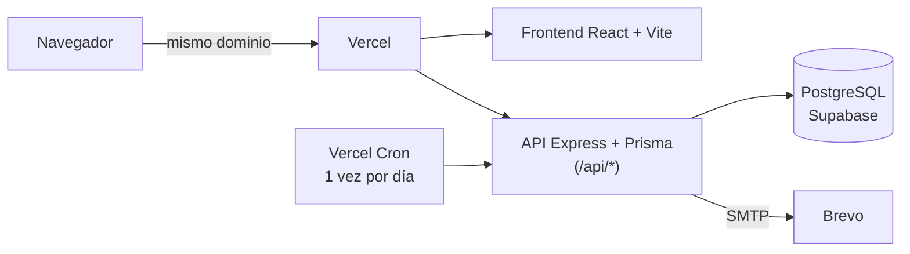

# Salux

[](https://github.com/cirocentu/Proyecto-Salux/actions/workflows/tests.yml)

**Sistema web de gestión de turnos médicos para una clínica universitaria.** Los pacientes reservan, reprograman y cancelan sus turnos sin llamar por teléfono; los médicos administran su agenda y su disponibilidad; la administración gestiona médicos y especialidades.

Proyecto de la cátedra de Desarrollo de Software. Está pensado para manejar datos de salud, así que la seguridad, la accesibilidad y la integridad de los turnos se tratan como requisitos, no como extras.

## Qué resuelve

| Rol | Qué puede hacer |
|---|---|
| **Paciente** | Registrarse y verificar su email · elegir especialidad, médico y un horario realmente libre · ver, reprogramar y cancelar sus turnos · confirmar su asistencia · consultar su historial |
| **Médico** | Ver su agenda · confirmar, finalizar o cancelar turnos · cargar su disponibilidad semanal y sus ausencias (vacaciones, días sueltos) |
| **Administrador** | Dar de alta, editar y activar o desactivar médicos · gestionar especialidades · ver todos los turnos |

Además: avisos por correo (turno creado, confirmado o cancelado), recuperación de contraseña, y cuatro modos visuales (oscuro, claro, alto contraste y "adulto mayor") con soporte completo de teclado.

## Cómo está construido



| Capa | Tecnología | Carpeta |
|---|---|---|
| Frontend | React 19, Vite, Tailwind | `src/` |
| API | Node.js 24, Express, Prisma, Zod | `backend/` |
| Base de datos | PostgreSQL (Docker en local, Supabase en producción) | `backend/prisma/` |
| Correo | Brevo por SMTP | `backend/src/utils/email.js` |
| Hosting | Vercel: frontend y API bajo un mismo dominio | `api/`, `vercel.json` |

Más detalle, con el modelo de datos y el flujo de una reserva: [`docs/ARQUITECTURA.md`](docs/ARQUITECTURA.md).

## Calidad: qué se verifica en cada pull request

Nada llega a `main` sin pasar el pipeline de [`.github/workflows/tests.yml`](.github/workflows/tests.yml):

| Control | Qué comprueba |
|---|---|
| Backend (Node 22 y 24) | ~100 pruebas unitarias y ~170 de integración contra PostgreSQL real: autenticación, roles, reglas de los turnos, carreras entre pedidos simultáneos |
| Frontend (Node 22 y 24) | Lint, ~290 pruebas de pantallas y del cliente de la API, y compilación |
| Accesibilidad | axe-core en un Chromium real: contraste, teclado y tamaño de los controles en 3 roles × 4 temas (WCAG 2.1 / 2.2 AA) |
| Docker | La imagen del backend se construye, no corre como root y no contiene tests ni credenciales |
| Esquema | Las migraciones aplican sobre una base vacía y coinciden con `schema.prisma` |
| Dependencias | Revisión de vulnerabilidades en dependencias nuevas y auditoría de producción |
| Análisis de código | CodeQL |

## Empezar en local

Necesitás Node 22+ y Docker.

```bash
# 1. Variables de entorno (completá los valores; hay un .env.example en cada carpeta)
cp backend/.env.example backend/.env

# 2. Base de datos + API + Redis
cd backend && docker compose up -d --build
node crearAdmin.js && node seedDemo.js      # administrador y datos de demostración

# 3. Frontend
cd .. && npm install && npm run dev          # http://localhost:5173
```

Guía completa del backend (variables, Docker endurecido, tests de integración): [`backend/README.md`](backend/README.md).

## Comandos habituales

| Comando | Para qué |
|---|---|
| `npm run dev` | Frontend en modo desarrollo |
| `npm test` | Pruebas del frontend (sin red ni base de datos) |
| `npm run test:a11y` | Accesibilidad en navegador real (primera vez: `npx playwright install chromium`) |
| `npm run lint` · `npm run build` | Lint y compilación |
| `cd backend && npm test` | Pruebas del backend (unitarias + integración; necesita la base de Docker) |

## Mapa del repositorio

```
src/            Frontend (React): pantallas, modales y cliente de la API
e2e/            Pruebas de accesibilidad en navegador real (Playwright + axe)
api/            Entrada de la API en Vercel (reutiliza backend/src/app.js)
backend/        API (Express + Prisma): código, migraciones, pruebas y scripts
docs/           Documentación del proyecto (índice en docs/README.md)
.github/        Pipelines de CI, plantillas de pull request e issues, Dependabot
```

## Documentación

| Documento | Contenido |
|---|---|
| [`docs/README.md`](docs/README.md) | Índice de toda la documentación, por tema |
| [`docs/ARQUITECTURA.md`](docs/ARQUITECTURA.md) | Componentes, modelo de datos, flujo de reserva y decisiones de diseño |
| [`docs/REGLAS-DE-NEGOCIO.md`](docs/REGLAS-DE-NEGOCIO.md) | Reglas de los turnos, estados permitidos y respuestas de la API |
| [`docs/DESPLIEGUE.md`](docs/DESPLIEGUE.md) | Publicar en Supabase + Vercel + Brevo, secretos, respaldos y checklist de plataformas |
| [`backend/scripts/respaldo/README.md`](backend/scripts/respaldo/README.md) | Respaldos cifrados de la base y cómo restaurarlos |
| [`CONTRIBUTING.md`](CONTRIBUTING.md) | Cómo colaborar: ramas, commits, pull requests y revisión |
| [`SECURITY.md`](SECURITY.md) | Cómo reportar una vulnerabilidad y qué medidas hay implementadas |

## Seguridad y datos personales

Los datos de salud son datos personales sensibles (Ley 25.326). Entre otras medidas: sesiones revocables con rotación del refresh token, límites contra fuerza bruta y abuso de correo, contraseñas con política mínima, base de datos accesible solo con un rol sin privilegios, contenedor sin root y de solo lectura, cabeceras de seguridad estrictas y respaldos cifrados. El detalle está en [`SECURITY.md`](SECURITY.md) y en la sección *Seguridad* de [`backend/README.md`](backend/README.md).

## Equipo

Proyecto de la cátedra de Desarrollo de Software (UTN FRLP).

| Integrante | GitHub | Área de responsabilidad |
|---|---|---|
| Justina | [@justinalozano](https://github.com/justinalozano) | Frontend y producto: pantallas, flujo del paciente y accesibilidad |
| Ciro Centurion | [@cirocentu](https://github.com/cirocentu) | Backend y seguridad: API, base de datos, autenticación y reglas de los turnos |
| Lucio Cantalupo | [@LucioCanta](https://github.com/LucioCanta) | Calidad e infraestructura: pruebas, pipeline de CI y despliegue |

## Estado

Desplegado y en funcionamiento (Vercel + Supabase). Licencia [MIT](LICENSE). Está pendiente adquirir un dominio propio para los correos (hoy los envía una cuenta de Brevo sin dominio verificado).
