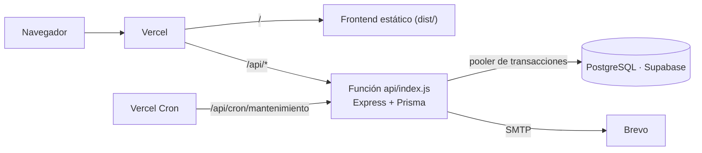
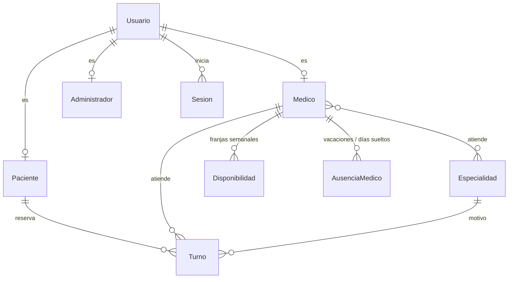
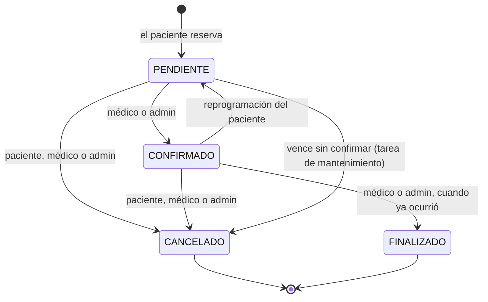
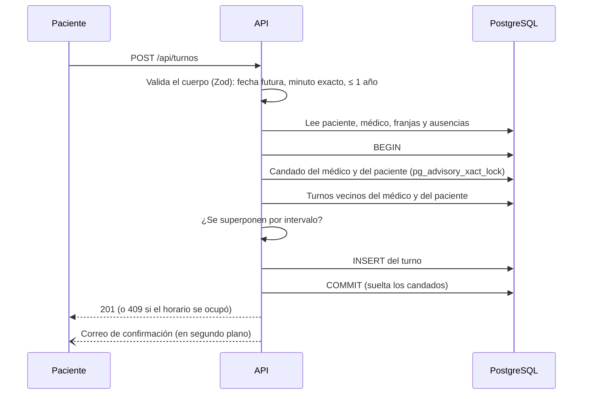

# Arquitectura de Salux

## Vista general

Un solo proyecto de Vercel sirve el frontend (archivos estáticos de Vite) y la API (`/api/*`, una función con Express) bajo el mismo dominio. Eso evita CORS y permite que la cookie de sesión funcione con `SameSite=strict`. La base de datos es PostgreSQL en Supabase, a la que la app se conecta directo con Prisma (no usa la API REST de Supabase).



En local el mismo backend corre en Docker (`backend/docker-compose.yml`) con PostgreSQL y Redis.

## Estructura del repositorio

```
src/                 Frontend React (pantallas, modales, cliente de la API)
e2e/                 Pruebas de accesibilidad en navegador real (Playwright + axe)
api/index.js         Entrada de la función de Vercel (reutiliza backend/src/app.js)
backend/
  src/
    app.js           Express: cabeceras, CORS, límites, rutas
    routes/          Una por recurso; aplican autenticación y validación
    controllers/     Reglas de negocio de cada recurso
    schemas/         Validación de entrada con Zod
    middlewares/     Autenticación, roles y validación
    utils/           Fechas (hora Argentina), correo, solapamientos, ids, límites
    jobs/            Mantenimiento periódico (turnos vencidos, sesiones)
    config/          Prisma, validación del entorno, almacén de límites
  prisma/            Esquema y migraciones
  test/              Unitarias e integración (node --test + supertest)
  scripts/           Secretos y respaldos cifrados
docs/                Esta documentación
.github/             Pipelines, plantillas de pull request e issues
```

## Modelo de datos



Decisiones que conviene conocer:

- **Un solo `Usuario` con perfil opcional por rol.** El rol se deduce de qué perfil existe (paciente, médico o administrador).
- **Borrado lógico.** Los médicos (`Usuario.activo`) y las especialidades (`Especialidad.activo`) no se borran: se desactivan, para conservar el historial de turnos.
- **Horas en Argentina.** La zona es UTC−3 todo el año. Los instantes se guardan en UTC; las franjas de disponibilidad se guardan como minutos desde la medianoche argentina y las ausencias como días calendario. Toda conversión pasa por `backend/src/utils/fechas.js`.
- **Sesiones en la base.** Cada inicio de sesión es una fila de `Sesion`: cerrar sesión o cambiar la contraseña las borra y los tokens dejan de valer al instante.

## Estados de un turno



`CANCELADO` y `FINALIZADO` son finales: no admiten más cambios. Las reglas completas están en [`REGLAS-DE-NEGOCIO.md`](REGLAS-DE-NEGOCIO.md).

## Flujo de una reserva y por qué es seguro ante pedidos simultáneos



Verificar "¿hay lugar?" y después guardar son dos pasos: sin protección, dos pedidos simultáneos leen la misma agenda vacía y ambos guardan. Los índices únicos de la base solo atajan el mismo instante exacto, no horarios que se pisan a medias (10:00 y 10:05). Por eso la reserva y la reprogramación corren en una transacción con un candado por médico y por paciente. Siempre se toma primero el del médico y después el del paciente, para que dos pedidos cruzados no se esperen entre sí. Los cambios de estado, en cambio, no usan candados: exigen en el `UPDATE` el estado que leyeron, y si otro pedido ya lo movió responden 409.

## Seguridad en capas

| Capa | Medidas |
|---|---|
| Red y navegador | HTTPS forzado, HSTS, CSP estricta, cabeceras de aislamiento (`COOP`, `CORP`), CORS con lista explícita |
| Autenticación | JWT de corta vida + refresh token en cookie `httpOnly`, rotado en cada renovación con detección de reutilización; máximo 10 sesiones por usuario |
| Abuso | Límites por IP y por cuenta (incluida fuerza bruta distribuida), límites de correos por destinatario |
| Datos | Contraseñas con bcrypt, política mínima, rol de base sin privilegios, RLS en Supabase, logs sin datos personales |
| Infraestructura | Contenedor sin root, solo lectura y sin capacidades; secretos solo en Vercel; respaldos cifrados |
| Proceso | Pipeline obligatorio, Dependabot, revisión de dependencias y CodeQL |

## Qué corre dónde (y en qué se diferencia Vercel)

| Tema | Docker / servidor propio | Vercel |
|---|---|---|
| Tarea de mantenimiento | Temporizador cada 10 min | Vercel Cron, 1 vez por día |
| Límites de intentos | Redis | Tabla `RateLimitContador` en la base |
| Correos | Se envían tras responder | Con `waitUntil`, para que no se corten |
| Conexión a la base | Directa | Pooler de transacciones de Supabase (`connection_limit=1`) |

Con el pooler de transacciones, dentro de una transacción de Prisma hay que usar siempre el cliente de la transacción (`tx`) y nunca el global: la conexión es una sola y el global quedaría esperándola para siempre.
